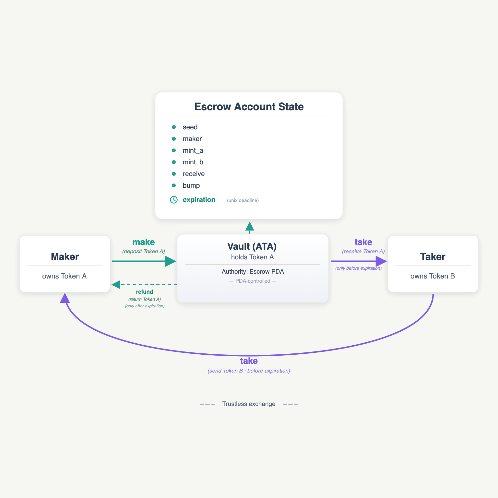
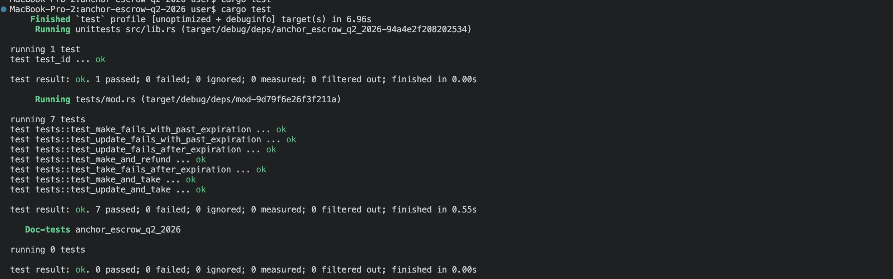

# Anchor Escrow

This program implements an **Escrow** contract to demonstrate the use of Anchor 1.0.0, upgraded to run on a **timed mechanism**: every escrow carries a unix deadline (`expiration`), and all instructions are gated against the clock sysvar.

The Escrow is a solana program which will hold on to the assets until a condition is met. There will be a user (`maker`) who defines the agreement conditions for the transaction: initiating the escrow and depositing a given amount of a given token (in this case, `amount_a` of `mint_a`) to the vault owned by our program in exchange for an amount of tokens (in this case, `amount_b` of `mint_b`) **within a given time window**. Now any user (`taker`) can take up their offer before the deadline and deposit the amount expected by the maker and receive the tokens from the vault to their account atomically. If nobody takes the offer before the deadline, the maker can reclaim the tokens from the vault once it has passed. So this is how we achieve a trustless, time-bound conditional transfer.



---

## Let's walk through the architecture:

For this program, we will have the Escrow state account that consists of:

```rust
#[account(discriminator = 1)]
pub struct Escrow {
    pub seed: u64,
    pub maker: Pubkey,
    pub mint_a: Pubkey,
    pub mint_b: Pubkey,
    pub receive: u64,
    pub bump: u8,
    pub expiration: i64
}
```

### In this state account, we will store:

- `seed`: A unique value chosen by the maker for PDA derivation; different seeds let the same maker open multiple escrows.

- `maker`: The user that will initiate the escrow.

- `mint_a`: The token that the maker is trading with.

- `mint_b`: The token that the maker is trading for.

- `receive`: The amount of mint_b that the maker wants to receive.

- `bump`: Since our Escrow account will be a PDA (Program Derived Address), we will store the bump of the account.

- `expiration`: The unix deadline (seconds since the epoch) of the agreement. This is the timed condition of the escrow: `take` is only possible **before** it, and `refund` is only possible **at or after** it. It is read and written against the clock sysvar (`Clock::get()?.unix_timestamp`).

The discriminator for this state account will be customized using the attribute macro  `#[account(discriminator = 1)]`, overriding the default 8-byte discriminator, to save resources and use only 1-byte. The discriminator needs to be unique for each type implemented, in this case only one is defined.

---

## The timed mechanism

The condition chosen for the timed escrow is **an expiration deadline stored on the escrow account**, enforced with the clock sysvar. The boundary semantics are:

```
───────────────────────────────┬───────────────────────────────▶ unix time
                            expiration

  take    → allowed only while now <  expiration
  refund  → allowed only while now >= expiration
  update  → allowed only while now <  expiration, and the new deadline must be in the future
  make    → the initial deadline must be in the future
```

So the taker is guaranteed the offer stays open for the whole window, and the maker can never reclaim the vault early; once the deadline passes, only `refund` is possible. At exactly `expiration`, `take` fails and `refund` succeeds — there is no overlap and no gap.

All four checks read the same source of truth, the clock sysvar:

```rust
let now = Clock::get()?.unix_timestamp;
```

| Instruction | Clock rule | Error if violated   |
|-------------|------------|---------------------|
| `make`      | `expiration > now`        | `InvalidExpiration` (6002) |
| `take`      | `now < expiration`        | `EscrowExpired` (6000)     |
| `refund`    | `now >= expiration`       | `EscrowNotExpired` (6001)  |
| `update`    | `now < expiration` and new `expiration > now` | `EscrowExpired` (6000) / `InvalidExpiration` (6002) |

---

### The maker will be able to define the deal conditions. For that, we create the following context:

```rust
#[derive(Accounts)]
#[instruction(seed: u64)]
pub struct Make<'info> {
    #[account(mut)]
    pub maker: Signer<'info>,
    #[account(
        mint::token_program = token_program
    )]
    pub mint_a: InterfaceAccount<'info, Mint>,
    #[account(
        mint::token_program = token_program
    )]
    pub mint_b: InterfaceAccount<'info, Mint>,
    #[account(
        mut,
        associated_token::mint = mint_a,
        associated_token::authority = maker,
        associated_token::token_program = token_program
    )]
    pub maker_ata_a: InterfaceAccount<'info, TokenAccount>,
    #[account(
        init,
        payer = maker,
        seeds = [ESCROW_SEED, maker.key().as_ref(), seed.to_le_bytes().as_ref()],
        space = Escrow::DISCRIMINATOR.len() + Escrow::INIT_SPACE,
        bump
    )]
    pub escrow: Account<'info, Escrow>,
    #[account(
        init,
        payer = maker,
        associated_token::mint = mint_a,
        associated_token::authority = escrow,
        associated_token::token_program = token_program
    )]
    pub vault: InterfaceAccount<'info, TokenAccount>,
    pub associated_token_program: Program<'info, AssociatedToken>,
    pub token_program: Interface<'info, TokenInterface>,
    pub system_program: Program<'info, System>,
}
```

Let´s have a closer look at the accounts that we are passing in this context:

- `maker`: The person that is creating the escrow. Will be a signer of the transaction, and we mark this account as mutable as we will be deducting lamports from this account.

- `mint_a`: The Mint Account that represents the asset to be sent by the maker (and received by the taker).

- `mint_b`: The Mint Account that represents the asset to be received by the maker (and sent by the taker).

- `maker_ata_a`:  The Associated Token Account that holds the token_a of the maker. This will be mutable as the assets are being transferred from this account.

- `vault`: This is an Associated Token Account to hold the token_a transferred from the maker, and held by the escrow agent, until the agreement is completed and the assets are either sent to the taker or refunded back to the maker. This account will be created and paid by the maker, but the escrow will hold the authority on the funds.

- `escrow`: The Escrow account will hold the state of the exchange agreement that we will initialize and that will be paid by the maker. We derive the Escrow PDA from the byte representation of the word "escrow", the reference of the maker's public key and the `seed`, and we store the canonical bump in the account.

- `token_program`: The token program.

- `associated_token_program`: The associated token program.

- `system_program`: The system program. Program responsible for the initialization of any new account.

### We then implement some functionality for our Make context:

```rust
impl<'info> Make<'info> {
    //Initialize escrow
    pub fn init_escrow(&mut self, seed: u64, receive: u64, bumps: &MakeBumps, expiration: i64) -> Result<()> {
        //The expiration must be a unix timestamp in the future, and the
        //maker must ask for at least one unit of mint_b, otherwise the
        //escrow is either instantly redeemable for nothing or untakeable.
        require!(expiration > Clock::get()?.unix_timestamp, ErrorCode::InvalidExpiration);
        require!(receive > 0, ErrorCode::InvalidReceiveAmount);

        self.escrow.set_inner(Escrow {
            seed,
            maker: self.maker.key(),
            mint_a: self.mint_a.key(),
            mint_b: self.mint_b.key(),
            receive: receive,
            bump: bumps.escrow,
            expiration: expiration,
        });
        Ok(())
    }

    //Deposit tokens from maker to vault
    pub fn deposit(&mut self, deposit: u64) -> Result<()> {

        let transfer_accounts = TransferChecked {
            from: self.maker_ata_a.to_account_info(),
            mint: self.mint_a.to_account_info(),
            to: self.vault.to_account_info(),
            authority: self.maker.to_account_info()
        };

        let cpi_ctx = CpiContext::new(self.token_program.key(), transfer_accounts);

        transfer_checked(cpi_ctx, deposit, self.mint_a.decimals)
    }
}
```

In the `init_escrow` function, we first validate that the `expiration` is a unix timestamp in the future and that the `receive` amount is greater than zero, then we initialize the escrow account. In this case, we use `set_inner`, to set the account data.

In the `deposit` function, we transfer tokens from the maker's associated token account to the vault account.

---

### The taker can then take the open offer and deposit the amount expected by the maker and receive the tokens from the vault to their account. For that, we create the following context:

```rust
#[derive(Accounts)]
pub struct Take<'info> {
    #[account(mut)]
    pub taker: Signer<'info>,
    #[account(mut)]
    pub maker: SystemAccount<'info>,
    pub mint_a: Box<InterfaceAccount<'info, Mint>>,
    pub mint_b: Box<InterfaceAccount<'info, Mint>>,
    #[account(
        init_if_needed,
        payer = taker,
        associated_token::mint = mint_a,
        associated_token::authority = taker,
    )]
    pub taker_ata_a: InterfaceAccount<'info, TokenAccount>,
    #[account(
        mut,
        associated_token::mint = mint_b,
        associated_token::authority = taker,
    )]
    pub taker_ata_b: InterfaceAccount<'info, TokenAccount>,
    #[account(
        init_if_needed,
        payer = taker,
        associated_token::mint = mint_b,
        associated_token::authority = maker,
    )]
    pub maker_ata_b: InterfaceAccount<'info, TokenAccount>,
    #[account(
        mut,
        close = maker,
        has_one = maker,
        has_one = mint_a,
        has_one = mint_b,
        seeds = [ESCROW_SEED, maker.key().as_ref(), escrow.seed.to_le_bytes().as_ref()],
        bump = escrow.bump,
    )]
    pub escrow: Account<'info, Escrow>,
    #[account(
        mut,
        associated_token::mint = mint_a,
        associated_token::authority = escrow,
    )]
    pub vault: InterfaceAccount<'info, TokenAccount>,
    pub associated_token_program: Program<'info, AssociatedToken>,
    pub token_program: Interface<'info, TokenInterface>,
    pub system_program: Program<'info, System>,
}
```

In this context, we are passing all the accounts that we need to transfer the token_b from the taker to the maker, transfer the token_a from the vault to the taker and close accounts:

- `taker`: The account of the person that is accepting the exchange proposed by the maker in the escrow.

- `maker`: The account of the person that initialized the escrow.

- `mint_a`: The mint of the token the maker is depositing and the taker is receiving.

- `mint_b`: The mint of the token the maker is receiving and the taker is sending.

- `vault`: The vault account that currently holds the tokens of token_a until the condition is met. Mutable because its funds are being transferred to the taker.

- `maker_ata_b`: The ATA of the maker for the token_b. This account may not exist yet, so the program will need to initialize it with 'init-if-needed'.

- `taker_ata_a`: The ATA of the taker for the token_a. This account may not exist yet, so the program will need to initialize it with 'init-if-needed'.

- `taker_ata_b`: The ATA of the taker from which the tokens of token_b is being transferred from. It needs to be mutable.

- `escrow`: The Escrow account that holds the state of the exchange agreement. In this example, we will be using the has_one constraint to validate the maker and the mints.

- `token_program`: The token program.

- `associated_token_program`: The associated token program.

- `system_program`: The system program.

### We then implement some functionality for our Take context:

```rust
impl<'info> Take<'info> {
    // Check if the escrow has expired
    pub fn check_expiration(&self) -> Result<()> {
        require!(Clock::get()?.unix_timestamp < self.escrow.expiration, ErrorCode::EscrowExpired);
        Ok(())
    }

    //Deposit tokens from taker to maker
    pub fn deposit(&mut self) -> Result<()> {

        let cpi_accounts = TransferChecked {
            from: self.taker_ata_b.to_account_info(),
            to: self.maker_ata_b.to_account_info(),
            authority: self.taker.to_account_info(),
            mint: self.mint_b.to_account_info(),
        };

        let cpi_ctx = CpiContext::new(self.token_program.key(), cpi_accounts);

        transfer_checked(cpi_ctx, self.escrow.receive, self.mint_b.decimals)
    }

    //Withdraw tokens from vault to taker and close vault
    pub fn withdraw_and_close_vault(&mut self) -> Result<()> {
        let signer_seeds: [&[&[u8]]; 1] = [&[
            ESCROW_SEED,
            self.maker.key.as_ref(),
            &self.escrow.seed.to_le_bytes()[..],
            &[self.escrow.bump]
        ]];

        let cpi_program = self.token_program.key();

        let cpi_accounts = TransferChecked {
            from: self.vault.to_account_info(),
            to: self.taker_ata_a.to_account_info(),
            authority: self.escrow.to_account_info(),
            mint: self.mint_a.to_account_info(),
        };

        let cpi_context = CpiContext::new_with_signer(cpi_program, cpi_accounts, &signer_seeds);

        transfer_checked(cpi_context, self.vault.amount, self.mint_a.decimals)?;

        let cpi_accounts = CloseAccount {
            account: self.vault.to_account_info(),
            destination: self.maker.to_account_info(),
            authority: self.escrow.to_account_info(),
        };

        let cpi_context = CpiContext::new_with_signer(cpi_program, cpi_accounts, &signer_seeds);

        close_account(cpi_context)
    }
}
```

In the `check_expiration` function, we enforce the timed mechanism against the clock sysvar: taking is only possible **before** the deadline. If the deadline has passed, the instruction fails with `EscrowExpired`.

In the `deposit` function, we transfer the token_b tokens from the taker's associated token account to the maker's associated token account.

In the `withdraw_and_close_vault` function, we transfer the token_a tokens from the vault account to the taker's associated token account. Given that the authority of the vault is the escrow, we need to pass the seeds while defining the context for the CPI.

And then, we close the vault account and rent is claimed by the maker. Since the transfer occurs from a PDA, we need to pass the seeds while defining the context for the CPI.


---

### The maker of an escrow can be refunded of the tokens that are in the vault and close the escrow account, but **only once the deadline has passed**. While the escrow is live, the taker is the only one who can redeem it. For that, we create the following context:

```rust
#[derive(Accounts)]
pub struct Refund<'info> {
    #[account(mut)]
    maker: Signer<'info>,
    mint_a: InterfaceAccount<'info, Mint>,
    #[account(
        mut,
        associated_token::mint = mint_a,
        associated_token::authority = maker,
    )]
    maker_ata_a: InterfaceAccount<'info, TokenAccount>,
    #[account(
        mut,
        close = maker,
        has_one = mint_a,
        has_one = maker,
        seeds = [ESCROW_SEED, maker.key().as_ref(), escrow.seed.to_le_bytes().as_ref()],
        bump = escrow.bump,
    )]
    pub escrow: Account<'info, Escrow>,
    #[account(
        mut,
        associated_token::mint = mint_a,
        associated_token::authority = escrow,
    )]
    vault: InterfaceAccount<'info, TokenAccount>,
    token_program: Interface<'info, TokenInterface>,
    system_program: Program<'info, System>,
}
```

In this context, we are passing all the accounts that we need to refund the funds and close the escrow account:

- `maker`: The account that is refunding the funds and closing the escrow account.

- `mint_a`: The mint of the token the maker has deposited on the vault.

- `maker_ata_a`:  The Associated Token Account of the maker for the token_a. Mutable because it will receive the funds back.

- `vault`: The vault account that currently holds the tokens of token_a until the condition is either met or canceled (refunded). Mutable because its funds are being transferred back to the maker.

- `escrow`: The Escrow account that holds the state of the exchange agreement.

- `token_program`: The token program.

- `system_program`: The system program.

### We then implement some functionality for our Refund context:

```rust
impl<'info> Refund<'info> {
    // The maker can only reclaim the funds once the deadline has passed.
    // While the escrow is live, the taker is the only one who can redeem it.
    pub fn check_expiration(&self) -> Result<()> {
        require!(
            Clock::get()?.unix_timestamp >= self.escrow.expiration,
            ErrorCode::EscrowNotExpired
        );
        Ok(())
    }

    //Refund tokens from vault to maker and close vault
    pub fn refund_and_close_vault(&mut self) -> Result<()> {
        // ... transfer vault -> maker_ata_a, then close the vault
    }
}
```

In the `check_expiration` function, we enforce the other half of the timed mechanism against the clock sysvar: refunding is only possible **at or after** the deadline. If the deadline has not passed yet, the instruction fails with `EscrowNotExpired`.

In the `refund_and_close_vault` function, we transfer the tokens from the vault account to the maker's associated token account.

And then, we close the vault account and rent is claimed by the maker. Since the transfer occurs from a PDA, we need to pass the seeds while defining the context for the CPI.

---

### The maker can update the deal terms (the `receive` amount and the `expiration`) of a live escrow, but only while the escrow is still open for taking. For that, we create the following context:

```rust
#[derive(Accounts)]
pub struct Update<'info> {
    pub maker: Signer<'info>,
    //Only the maker can update the terms, and only while the escrow is
    //still open: once the deadline passes the escrow can only be refunded.
    #[account(
        mut,
        has_one = maker,
        seeds = [ESCROW_SEED, maker.key().as_ref(), escrow.seed.to_le_bytes().as_ref()],
        bump = escrow.bump,
    )]
    pub escrow: Account<'info, Escrow>,
}
```

In this context, we are passing all the accounts that we need to update the deal terms of a live escrow:

- `maker`: The account of the person that initialized the escrow. Must sign, and is validated against the escrow with the `has_one` constraint.

- `escrow`: The Escrow account that holds the state of the exchange agreement. Mutable, because we will overwrite `receive` and `expiration`. The seeds and bump validate that the account belongs to this maker.

### We then implement some functionality for our Update context:

```rust
impl<'info> Update<'info> {
    //Update the deal terms (receive amount and expiration) of a live escrow.
    //The vault balance, mints and seed are immutable: to change those,
    //the maker has to refund and open a new escrow.
    pub fn update_terms(&mut self, receive: u64, expiration: i64) -> Result<()> {
        let now = Clock::get()?.unix_timestamp;

        //The escrow can only be updated before the current deadline passes.
        require!(now < self.escrow.expiration, ErrorCode::EscrowExpired);
        //The new deadline must be a unix timestamp in the future.
        require!(expiration > now, ErrorCode::InvalidExpiration);
        //The maker must ask for at least one unit of mint_b.
        require!(receive > 0, ErrorCode::InvalidReceiveAmount);

        self.escrow.receive = receive;
        self.escrow.expiration = expiration;

        Ok(())
    }
}
```

- Only the maker (the signer) can update the terms, and only **before** the current deadline passes; after it, the escrow can only be refunded and `update` fails with `EscrowExpired`.
- The new deadline must also be in the future (`InvalidExpiration`), and the `receive` amount must be greater than zero (`InvalidReceiveAmount`).
- The `receive` amount and the `expiration` are the only fields that can change. The seed, the mints and the vault balance are immutable; to change those, the maker has to refund the escrow and open a new one.

---

### The instructions of the program are also using custom discriminators as demonstrated below:
- **Custom discriminators**: Discriminators of 1-byte are used to override the default 8-byte discriminators, both for the instructions and for the `Escrow` account.

```rust
#[program]
pub mod anchor_escrow_q2_2026 {
    use super::*;

    #[instruction(discriminator = 0)]
    pub fn make(ctx: Context<Make>, seed: u64, deposit: u64, receive: u64, expiration: i64) -> Result<()> {
        ctx.accounts.init_escrow(seed, receive, &ctx.bumps, expiration)?;
        ctx.accounts.deposit(deposit)
    }

    #[instruction(discriminator = 1)]
    pub fn take(ctx: Context<Take>) -> Result<()> {
        ctx.accounts.check_expiration()?;
        ctx.accounts.deposit()?;
        ctx.accounts.withdraw_and_close_vault()
    }

    #[instruction(discriminator = 2)]
    pub fn refund(ctx: Context<Refund>) -> Result<()> {
        ctx.accounts.check_expiration()?;
        ctx.accounts.refund_and_close_vault()
    }

    #[instruction(discriminator = 3)]
    pub fn update(ctx: Context<Update>, receive: u64, expiration: i64) -> Result<()> {
        ctx.accounts.update_terms(receive, expiration)
    }
}
```

In this case, we will use 1-byte discriminators for the instructions in the lib.rs, overriding the default 8-byte:

| Instruction | Discriminator |
|-------------|---------------|
| `make`      | 0             |
| `take`      | 1             |
| `refund`    | 2             |
| `update`    | 3             |
| `Escrow` account | 1         |

---

## Testing

The program is covered by Rust **LiteSVM** tests (no validator needed). The suite lives in `programs/anchor-escrow-q2-2026/tests/mod.rs` and exercises every instruction, including the time-based branches by warping the clock sysvar (`program.set_sysvar(&clock)`). The tests start from a realistic base time (`NOW = 1_800_000_000`) rather than LiteSVM's default all-zero clock.

To run them:

```bash
anchor build   # builds the .so that the LiteSVM tests load
cargo test
```

Expected output:

```
running 1 test
test test_id ... ok

running 7 tests
test tests::test_make_fails_with_past_expiration ... ok
test tests::test_update_fails_after_expiration ... ok
test tests::test_update_fails_with_past_expiration ... ok
test tests::test_make_and_refund ... ok
test tests::test_take_fails_after_expiration ... ok
test tests::test_make_and_take ... ok
test tests::test_update_and_take ... ok

test result: ok. 7 passed; 0 failed
```

Screen-shot:


Coverage:

| Test | What it checks |
|------|----------------|
| `test_make_and_refund` | `make` deposits into the vault; `refund` fails before the deadline (`EscrowNotExpired`), succeeds after it, returns the tokens and closes both accounts |
| `test_make_and_take` | `make`; `take` 30 minutes before the deadline works: vault tokens go to the taker, payment goes to the maker, escrow/vault are closed |
| `test_take_fails_after_expiration` | `take` exactly at the deadline fails with `EscrowExpired`; escrow and vault stay intact |
| `test_update_and_take` | `update` changes `receive` and `expiration` on a live escrow; `take` afterwards settles with the updated terms |
| `test_update_fails_after_expiration` | `update` at/after the deadline fails with `EscrowExpired` |
| `test_update_fails_with_past_expiration` | `update` with a new deadline in the past fails with `InvalidExpiration` |
| `test_make_fails_with_past_expiration` | `make` with an expiration in the past fails with `InvalidExpiration`; no accounts are created |

There is also a TypeScript client test suite in `tests/anchor-escrow-q2-2026.ts` (run against a local validator with `anchor test`). Note that its `Refund!` case is `xit`-disabled because the refund now requires the deadline to pass first, which is awkward to reach on a real validator; the LiteSVM suite covers the refund path, including the boundary.

---

## Repository layout

```
.
├── Anchor.toml                 # program id, cluster, scripts
├── Escrow.svg                  # diagram source (edit this, then re-render Escrow.png)
├── Escrow.png                  # architecture diagram
├── programs/anchor-escrow-q2-2026/
│   ├── src/
│   │   ├── lib.rs              # instruction handlers & discriminators
│   │   ├── state.rs            # Escrow account
│   │   ├── constants.rs        # ESCROW_SEED
│   │   ├── error.rs            # ErrorCode (EscrowExpired, EscrowNotExpired, ...)
│   │   └── instructions/       # make.rs, take.rs, refund.rs, update.rs
│   └── tests/mod.rs            # LiteSVM integration tests
└── tests/anchor-escrow-q2-2026.ts  # TypeScript client tests (local validator)
```
